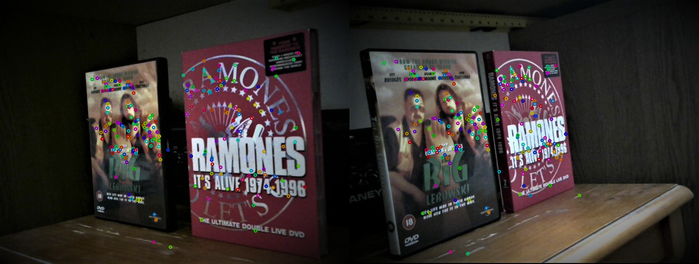
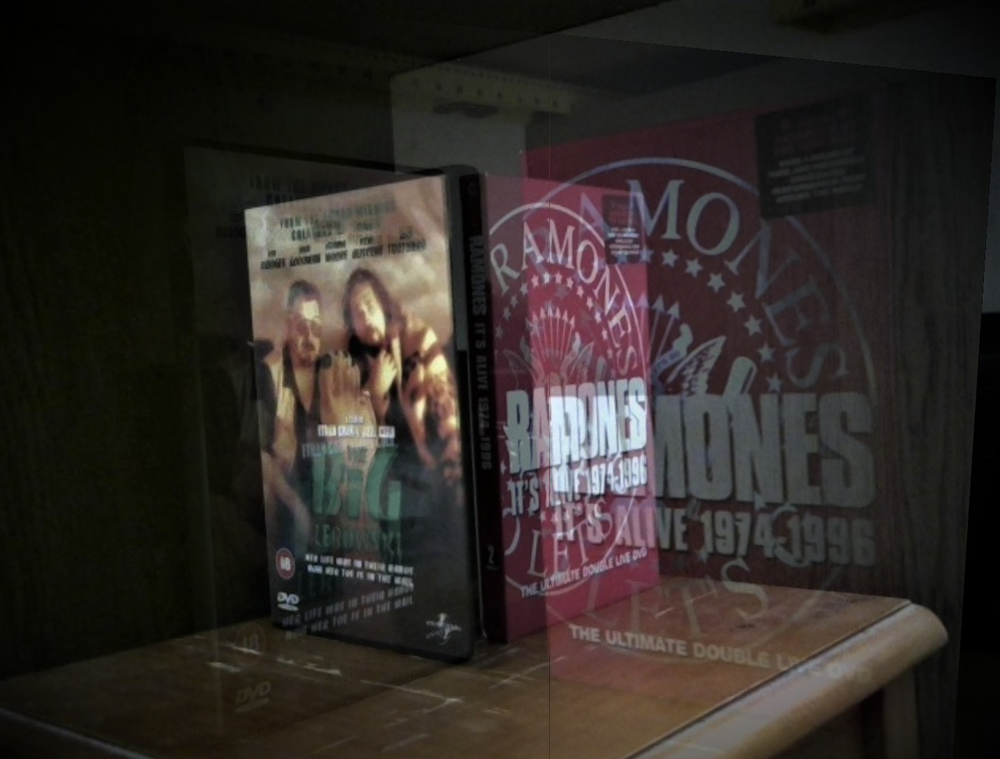
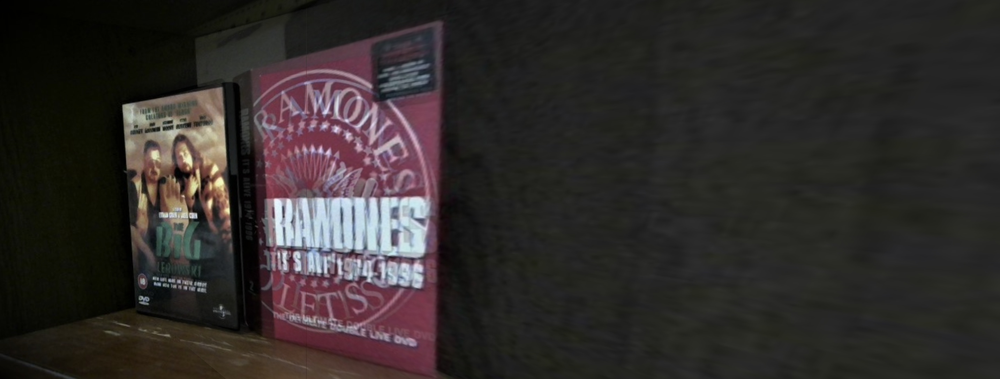
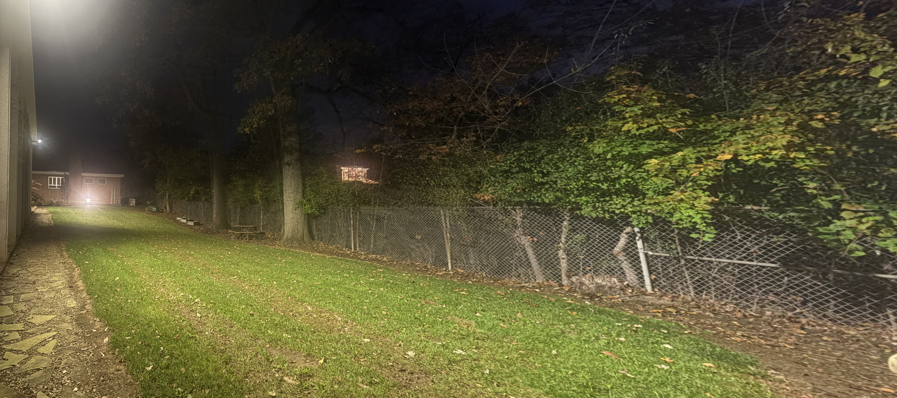
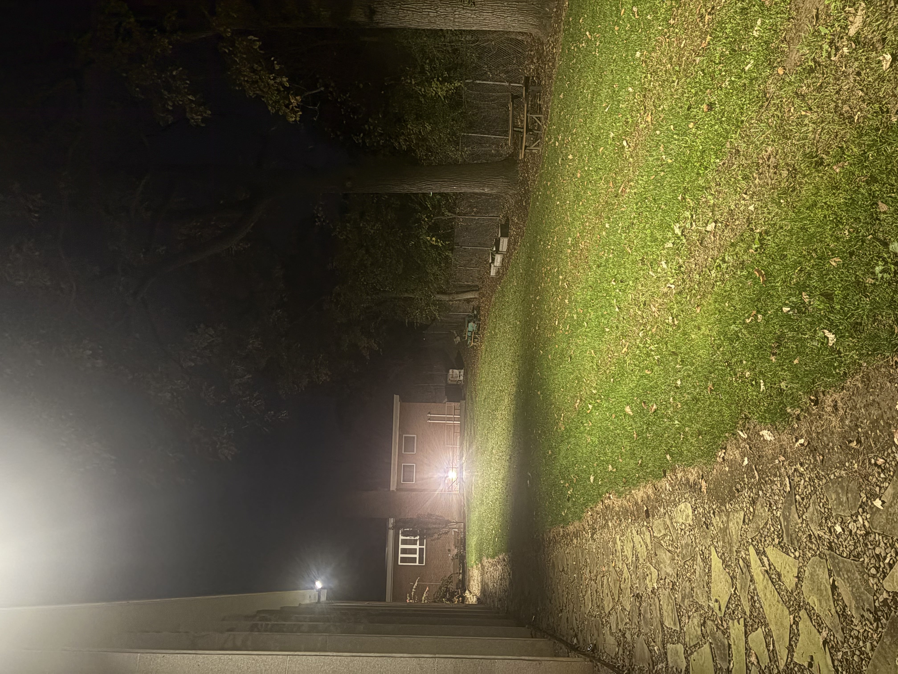

Running Program
```bash
# Create virtual env
python -m venv .venv
# activate virtual environment
source ./bin/activate
# install dependencies
pip install -r requirements.txt
python ./src/main.py + args

positional arguments:
  image_path

```

```
options:
  -h, --help            show this help message and exit
  --transform_algorithm TRANSFORM_ALGORITHM
                        Affine Transform = 0 | Homography Transform = 1
  --ransac_threshold RANSAC_THRESHOLD
                        Maximum reprojection error to consider a point as an inlier, default 3.0
  --ransac_max_iterations RANSAC_MAX_ITERATIONS
                        Maximum iterations for ransac
  --neighbor_threshold NEIGHBOR_THRESHOLD
                        threshold for nearest neighbor, default=0.75
  --debug_draw DEBUG_DRAW
                        outputs images for debugging matches Matches=1 | RANSAC=2
  --show_outlier SHOW_OUTLIER
                        shows outliers for debug_draw only when it is set to 2
  --use_mean USE_MEAN   set to 1 if you want reprojection error to be calculated with mean, 0 for median
```


Output: new_image.jpg in repository's directory

# Feature Matching Evaluation
```
The image pair that I used to compare nearest-neighbor ratios was the DVD. The main reason why I chose DVD was because it has a high median of reprojection errors before performing ransac. This is important because if the median of reprojection errors before performing ransac is low enough to basically be the reprojection after performing ransac there is no use in further tightening the matching threshold because the outcome will be near identical.
`neighbor_threshold = 0.75`
DVD reprojection median before after ransac:
  before: 30.05
  after: 1.0
uttower reprojection median:
  before: 0.51
  after: 0.47
`neighbor_threshold = 0.4`
DVD reprojection median before after ransac:
  before: 0.46
  after: 0.44
uttower reprojection median:
  before: 0.40
  after: 0.40
We can see that the outcome of tightening the threshold for the DVD pair made a far greater change than it did for the uttower pair, as changing the threshold of the uttower pair.
Matches
Total_matches: 1811
Here is the dvd pair with a threshold of 0.75:
`kept_matches = 221`

Here is the dvd pair with a threshold of 0.4:
`kept_matches = 14`

Here is the dvd pair with a threshold of 0.35
While giving a look at the dvd matches with a threshold of 0.75 it didn't take me long to find inconsistent pixels which didn't come as a surprise as half of the errors were at least 30 pixels away. The most egregious error I found was a match on the circular border of the purple book's logo right underneath the top right black square of text on the left picture. On the right picture the matched point can be found on the seam of the scratched wood, right underneath the bottom right corner of the same book.
The tradeoff we experience when lowering the neighbor threshold is that we keep keypoint matches that are more unique than the next best match but in return we may filter out perfectly good points if the neighbor_threshold is too low.
```
# RANSAC Evaluation
```
Metric	Value
Matches	221
inlier_cnt	38
outlier_cnt	183
mean reprojection before RANSAC	126.4
mean reprojection after RANSAC	1.42
```
The reprojection error after RANSAC are the points presented in this photo

The reprojection error before RANSAC is the union of the photo above and the one below

# Affine vs Homography
Affine

inlier_cnt: 8
reprojection_error: before=15.5, after=0.58
Homography

inlier_cnt: 11
reprojection_error: before=4.7, after=0.48
```
The first image shows us the affine transform while the second image shows us the homography transform
This image pair shows the largest visual difference between a Affine and Perspective transform. The reason why the Affine looks so much worse than the perspective transform is because the perspective of the camera changed drastically enough that the vanishing point of both photos were on completely opposite end of each other. Affine simply does not have the flexibility to change the vanishing point of an image. Perspective Transform does not have this issue, as it has 8 degrees of freedom compared to Affine's 6
The reprojection error after RANSAC in the affine transform surprised me, as it looked shockingly low for how bad the output looked. When looking at the inliers I soon realized why. The inliers are clustered together and so the result was biased in making sure that the cluster was matched as best as possible and since the points were close to one another the vanishing point was not accentuated enough to make a difference.


uttower
Affine
inlier_cnt: 120
reprojection_error: before=2.87, after=1.03
Homography
inlier_cnt: 170
reprojection_error: before=0.67, after=0.50
unsurprisingly, the homography outperforms the affine transform but the affine transform still performed really well!
the uttower pair has similar vanishing points which allows the affine stitch much more realistically than the dvd pair. One pattern that I noticed, however, was that affine's inliers, once again, tended to cluster together a lot more than the Homography transform.
```

# Multiple-Image Panorama's

The reference images to all of the image groups, by design, is the highest numbered image within the group. For this panorama it should be

This is because my program iterates, in reverse, through a folder that has a group of images. Since files will be ordered alphanumerically,
if all of the file names are the same up until the number then it will be ordered from lowest to greatest.
